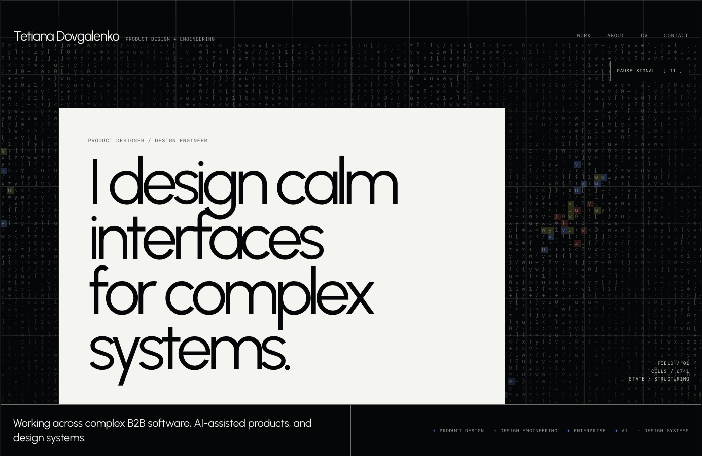
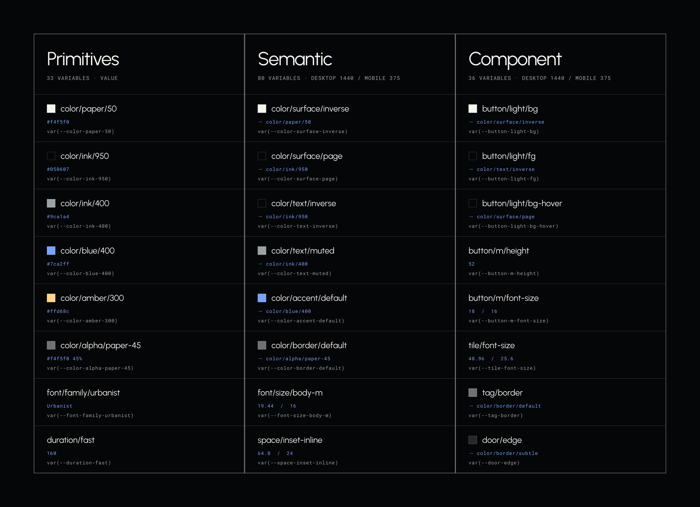
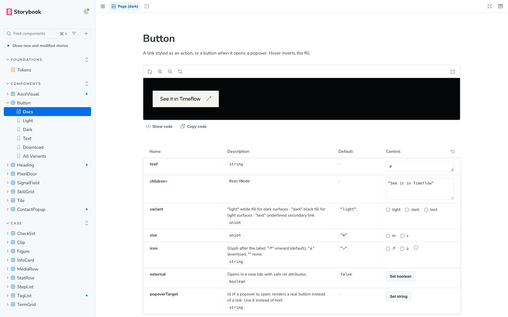
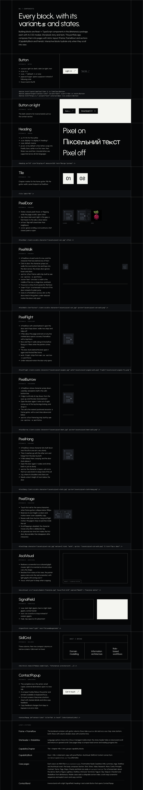

# Design to production – portfolio and design system

My portfolio site, built on a design system I designed and shipped myself: from Figma variables to tokens, React components, Storybook and a tested, deployed Astro site. The repo is the case study – it shows how a design decision travels all the way into production code.

**[Live site](https://bllondis.github.io/design-to-production)** · **[Design system docs](https://bllondis.github.io/design-to-production/system/)** · **[Storybook](https://bllondis.github.io/design-to-production/storybook/)**



---

## The pipeline

```
Figma variables  ──►  DTCG tokens  ──►  CSS custom properties  ──►  React components  ──►  Astro site
(3 collections)       (3 tiers)         (Style Dictionary)          (Storybook, tests)      (e2e, a11y, CI)
```

One change to a token in Figma has a clear path to every page that uses it, and nothing in between is hardcoded.

## What makes it a system, not a stylesheet

**Three token tiers, mirrored one-to-one in Figma**

- **Primitives** – raw values (the ink scale, sizes)
- **Semantic** – roles such as `color.text.muted` or `space.inset`
- **Component** – decisions a single component makes, such as `button.light.bg`, always pointing at semantic tokens

Components may only use semantic and component tokens, never primitives or raw hex. Tokens are written in the W3C DTCG format and built into CSS with Style Dictionary.



**A component library with its own contract**

`@tetiana/ui` – React + TypeScript components, each with a CSS module, a Storybook story and tests: `Button`, `Heading`, `Tile`, `PixelDoor`, `AsciiVisual`, `SignalField`, `SkillGrid`, `ContactPopup`, `StatRow`, `Lightbox`, `Figure`, `StepList` and more. Variants are props, not copies.

**Documented twice** – in Storybook, and on a live `/system` page inside the site itself, where every block is shown with its variants, states and usage code.





## Quality is part of the design

- **Accessibility** – automated axe checks on every page, real accessible names, decorative canvases hidden from screen readers
- **Reduced motion** – every animation stops under `prefers-reduced-motion`; canvases draw a still frame
- **Visual regression** – Playwright snapshots of key sections on desktop and mobile
- **Performance** – only interactive components are hydrated, and only when they scroll into view
- **CI** – lint, format, type check, unit tests, build and end-to-end tests on every push

## Built with AI, governed by the system

The site was built with AI coding agents. [`AGENTS.md`](AGENTS.md) is the rulebook they follow: use tokens, reuse components before creating new ones, keep content in data, respect motion and accessibility rules, and run the checks before finishing. The design system is what keeps AI-generated code consistent – the agents write code, the system and I decide what's allowed.

## Case studies on the site

- **[Design to production](https://bllondis.github.io/design-to-production/work/design-to-production/)** – the story of this repo: three token tiers, Figma variables that mirror them, React components and CI
- **[Timeflow](https://bllondis.github.io/design-to-production/work/timeflow/)** – AI timesheet assistant, solo from research to a deployed full-stack app
- **[DutchWaffle](https://bllondis.github.io/design-to-production/work/dutchwaffle/)** – Dutch learning app, from an AI design prototype to a cross-platform Expo build
- **[DocuStream](https://bllondis.github.io/design-to-production/work/docustream/)** – B2B SaaS for UCC filing management
- **[BookIT](https://bllondis.github.io/design-to-production/work/bookit/)** – new admin modules for an enterprise ERP platform

Each case is an MDX file composed from the same case components, so a new case is a content change, not new markup.

---

## Repo structure

```
packages/
  tokens/      @tetiana/tokens   DTCG design tokens → CSS custom properties (Style Dictionary)
  ui/          @tetiana/ui       React + TypeScript components, Storybook, unit tests
apps/
  portfolio/   portfolio         Astro site, /system docs page, end-to-end tests, hosting worker
```

The site consumes the design system as packages through npm workspaces, so changes show up immediately without publishing, while the boundary between product and system stays explicit.

**Stack:** Astro · React 19 · TypeScript · CSS Modules · Style Dictionary · Storybook · Vitest + Testing Library · Playwright + axe · GitHub Actions

## Commands

Run from the repo root.

| Command             | What it does                                                                               |
| ------------------- | ------------------------------------------------------------------------------------------ |
| `npm install`       | Installs every workspace                                                                   |
| `npm run dev`       | Portfolio on http://localhost:4321 (design system docs at `/system/`)                      |
| `npm run storybook` | Storybook on http://localhost:6006                                                         |
| `npm run tokens`    | Rebuilds `@tetiana/tokens` after editing token source files                                |
| `npm run cv`        | Rebuilds the CV PDF in `apps/portfolio/public` from `apps/portfolio/resume/resume.html`    |
| `npm run build`     | Site into `dist/client`, Storybook into `dist/client/storybook`, worker into `dist/server` |
| `npm test`          | Component unit tests (Vitest + Testing Library)                                            |
| `npm run test:e2e`  | Builds, then Playwright: behaviour, axe accessibility, visual snapshots                    |
| `npm run lint`      | ESLint across all workspaces                                                               |
| `npm run typecheck` | TypeScript in every workspace                                                              |
| `npm run format`    | Prettier                                                                                   |

---

Designed and built by **Tetiana Dovgalenko** – Product Designer & Design Engineer, The Hague. [LinkedIn](https://www.linkedin.com/in/tanya-dovgalenko/)
